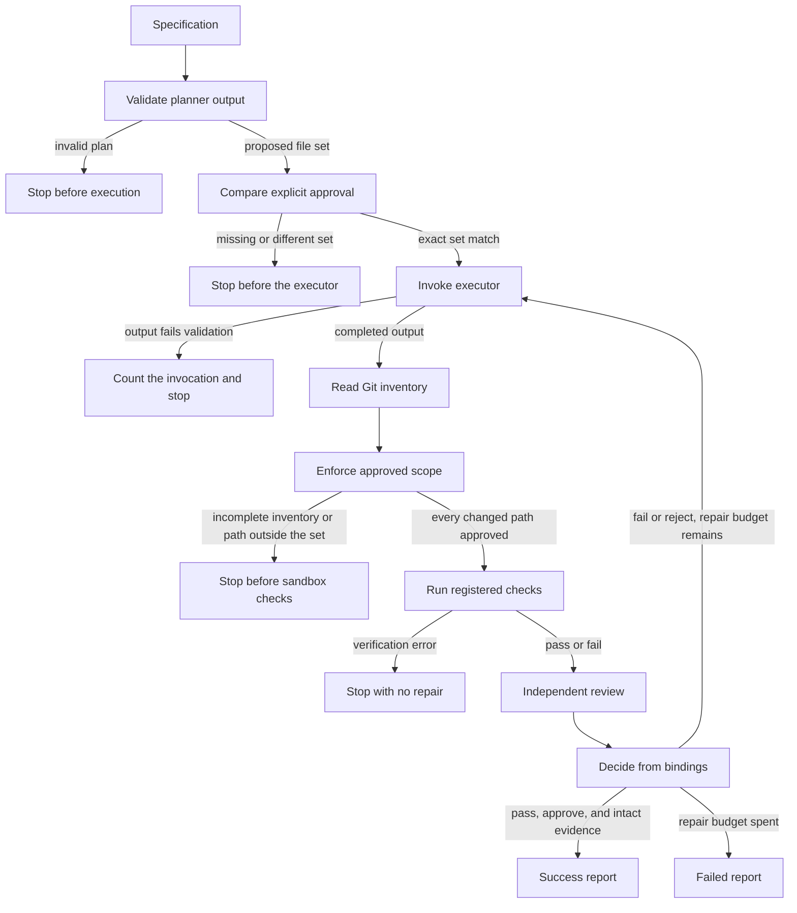

# Agentic Dev Workflow

An agent that can edit a repository can also report success for a change it did not make, a file nobody approved, or a check that never ran. This repository is a local control loop that keeps those outcomes apart.

A planner may name files. Execution waits until a person approves that exact set. Git then reports the paths that actually changed. Registered checks run through a sandbox contract. A separate reviewer sees the check result. A failed check or a rejected review can be repaired at most twice. Reviewer approval cannot turn a failed check into success.

The orchestration graph composes those contracts with mock agents and an in-memory sandbox. The command-line demo still runs an older mock graph. Neither path calls a live model.

## Orchestration lifecycle



A checkpoint may pause before execution, verification, review, or the decision. Resume checks the saved specification, retry limit, repository root, approved set, and evidence bindings before the graph continues.

## Architecture

`run_orchestration` is the workflow caller. Each stage returns a validated result or stops. A later stage does not reinterpret an earlier failure as success.

**Planner.** The planner returns steps. The proposed scope is the union of each step’s `expected_files`, in first-seen order. Malformed planner output stops the run before the executor.

**Approval.** The caller passes a `ScopeApproval` tuple. The approved paths must equal the proposed set. A missing approval ends at `awaiting_approval`. A wider or narrower set ends at `scope_mismatch`. Approval is a human decision recorded by the caller. The inventory module does not grant it.

**Task input.** `load_task_specification` accepts an inline string, a spec file, or both when the file bytes equal the inline string. A missing source, whitespace-only text, and two different texts raise `ValueError` before the graph starts. The same string is stored as `spec_text`, sent to the planner as its task, and placed in the executor and reviewer context under `specification`. Retries and checkpoint resume keep that string. The published orchestration report does not copy it. `run_orchestration` still accepts the resolved string directly, so a caller that already loaded `SPEC.md` does not change.

A multiline inline task:

```text
Create greeting.py with greet(name) returning "Hello, {name}!".
Create tests/test_greeting.py for a normal name and an empty string.
Use only runner.tests.
```

`scripts/live_cursor_feature.py` is the disposable-repository runner. It refuses a repository outside `/tmp/agentic-feature-test-*`. `--task` passes the inline text. With no `--task`, an existing `SPEC.md` in that repository is still the specification. `--approve PATH` may be repeated and is the only approval; omit it and the run stops at `awaiting_approval`. The runner does not approve the planner's proposed paths by itself. `runner.tests` discovers modules under `tests/`, so a root-level test module is not the registered check. `runner.compile` expects both `src/` and `tests/`.

Greeting demo, without creating `SPEC.md`, after an empty Git commit in a disposable feature repository:

```bash
AGENTIC_RUN_ID=greet01 \
AGENTIC_REPORT_PATH=/tmp/agentic-feature-test-greeting/live-run-report.json \
.venv/bin/python scripts/live_cursor_feature.py \
  --repository /tmp/agentic-feature-test-greeting/feature \
  --task "$(cat <<'EOF'
Create greeting.py with greet(name) returning "Hello, {name}!".
Create tests/test_greeting.py.
Test greet("Ada") and greet("").
Change only those two files.
verification_check_ids must be exactly runner.tests.
EOF
)" \
  --approve greeting.py \
  --approve tests/test_greeting.py
```

The approved names are the caller's allowed set. If the planner proposes any other path, the run stops with `scope_mismatch` and does not edit the worktree.

**Run summary.** Every orchestration report includes `summary`. A live report also includes `run_summary`, rebuilt from the sanitized planning report, agent calls, and Jaeger trace id. The summary gives the outcome, run id, wall-clock elapsed time, verification status, approval status, retries, scope-violation codes, and the stop reason. Each agent row separates wall-clock duration from the CLI `duration_ms`. Token totals add each invocation once. Cache read and cache write stay separate from input tokens. A missing counter is `unavailable`, not zero. A partial snapshot stays `partial` and does not become a token total.

The installed Cursor CLI prints a display name such as `Auto` and four token counters. It does not print a provider model id, a price, or a skill event. Model identity, cost, and skill status stay `unavailable`. The summary does not estimate a price from tokens. An actual cost is recorded only when a provider supplies one. `usage_by_run` remains the per-run counter aggregate. The workflow total sums those runs once and does not add the per-call rows again.

**Executor.** The executor receives the approved paths and the current attempt. The graph counts every call in `executor_invocations`. It opens a verification attempt only when the executor output validates as completed. Invalid output is an error on that invocation, and the sandbox does not run.

**Git change inventory.** After a completed executor result, the graph reads one `git status --porcelain=v2 -z` snapshot from the canonical worktree path on the verified handle. The read uses a scrubbed Git environment, a direct argument vector, a timeout, and an output cap. Staged, unstaged, and untracked changes are in scope. Both ends of a rename or copy count. The snapshot is a record of what Git reported. It is not an approval.

**Approved-scope enforcement.** `validate_approved_scope` compares that snapshot to the approved tuple. One path outside the set, including a rename destination, stops the attempt with `out_of_scope` before any sandbox call. The same canonical root is passed to `lock_check_applies` when the plan includes the dependency-file check.

**Registered verification checks.** The registry fixes four check ids for this runner repository: `runner.tests`, `runner.compile`, `runner.diff-check`, and `runner.lock-check`. Each definition owns its arguments, timeout, output cap, applicability, and environment profile. The lock check applies when `pyproject.toml`, `uv.lock`, or `uv.toml` is added, deleted, changed, or is either end of a rename or copy. The check runs only from an inventory this process issued for the same repository root. A copied inventory, a deep-copied inventory, or a snapshot bridged from another root is rejected.

**Independent reviewer.** The reviewer receives the verification outcome, evidence references, and attempt number. `approve` is valid only when the reviewer output contains no blocking finding. The reviewer does not see raw sandbox stdout or stderr. Those bytes stay on the sandbox result, hidden from its repr, and they are omitted from the orchestration report.

**Bounded repair.** `max_retries` is an integer from 0 through 2. A verification `fail` or a reviewer rejection may repair while `repair_retries_used < max_retries`. Each repair repeats execution, inventory, scope, checks, and review. The approved set stays the set from the original approval. A verification `error`, including `UnavailableSandboxRunner`, is terminal and does not consume a repair.

**Decision and evidence.** Success requires a passing verification, an approve decision, and process-local HMAC-SHA256 bindings that still match. One binding is written only after the executor output validates. It covers the run id, repository root, attempt, invocation count, and approved paths. Another covers the verification payload. A third covers the review decision together with the latest history entry. A fourth covers the full public attempt history. Resume at `verify`, `review`, `decide`, or a later `execute` checks the bindings required for that point before `graph.invoke`. A fresh pause before the first execution requires the execution binding and the history binding to be absent.

**Checkpoints.** Orchestration state uses checkpoint format version 2. The mock graph uses format version 1 and a different thread id, `agentic-dev-workflow:{run_id}` rather than `agentic-dev-workflow:orchestration:{run_id}`. The orchestration default saver is in-memory. A caller can inject the existing SQLite saver. A checkpoint missing `execution_binding` or `history_binding` fails as incomplete while the format number stays 2. A version other than 2 is rejected as incompatible.

**Result reporting.** The report carries outcome, attempts, executor invocations, repairs used, the current checks, the review decision, errors, and per-attempt history. `attempts` counts executor completions that reached verification. Current checks belong to the latest attempt that reached verification. An inventory or scope failure on a later attempt records `not_run` and a `terminal_error` for that attempt, and leaves the earlier attempt’s checks on its own history entry.

## Execution walkthrough

The deterministic demo in `scripts/demo_orchestration.py` runs three scenarios against temporary Git repositories. The approved file is `notes.txt`. The plan asks for `runner.tests` and `runner.lock-check`. Only `notes.txt` changes, so the lock check is skipped and the sandbox is asked to run `runner.tests`. The reviewer returns `approve` in every scenario. Mock agents and a scripted runner supply the results. The repository under development is not the target.

**Success.** The sandbox returns passed on attempt 1. `max_retries` is 0. The report is `success`, with one verification attempt, one executor invocation, no repair, and review decision `approve`.

**Repair, then success.** Attempt 1 returns a failed `runner.tests` check. The reviewer still approves. The decision treats that as a verification failure and spends the one allowed repair. Attempt 2 returns passed. The report is `success`, with two attempts, two executor invocations, and `repair_retries_used` of 1. History is `fail`, then `pass`.

**Retry exhaustion.** Both attempts return a failed check. `max_retries` is 1, so the second failure has no repair left. The report is `failed`, with errors `verification_failed` and `retries_exhausted`. The executor has been called twice. The review decision on the report remains `approve`, which shows that the review did not override the checks.

## Technical design

**Explicit contracts.** Planner, executor, verifier, and reviewer outputs pass through validators before the graph trusts them. The sandbox accepts a canonical registry definition and a `VerifiedWorktree` built from a successful manager verification record. The handle’s path must already be the canonical root. Orchestration does not create a managed worktree of its own.

**Fail-closed validation.** Unknown planner fields, a non-integer retry limit, a bool used as an integer, an incomplete inventory, an unavailable sandbox, and a check result that claims `passed` with output above the registered cap are rejected. The runner boundary repeats the cap check so a backend cannot hand back an over-limit pass. A passed result also requires exit code 0, natural termination, successful cleanup, and no failure category.

**Repository-bound inventory evidence.** Issuance attaches an HMAC over the inventory entries, the live object, and the canonical root. `lock_check_applies` recomputes that MAC. Public construction of a complete inventory is rejected. An unbound inventory cannot be used by naming a repository root after the fact.

**Checkpoint integrity.** The bindings use one process-local key and canonical JSON (`sort_keys`, compact separators). `_matches` requires a string of equal length and then `hmac.compare_digest`. Edited counters, a rewritten earlier history entry, a reordered history, or a dropped binding fail the resume check before the executor, reviewer, or sandbox runs again. `decide` also requires the bindings before it reports success.

**Bounded retries.** The sandbox attempt id is capped at 3, so the repair budget stops at 2. The limit is checked before the graph starts and again on resume. Raising `max_retries` at resume time, or presenting a different approval or root, is rejected. The in-graph executor refuses an attempt past `max_retries + 1`.

**Verification errors.** A failed test is a `fail` and may be repaired. A runner that cannot execute the check is an `error`. Errors include unavailable sandbox, launch failure, timeout, output overflow, and uncertain cleanup. The decision step does not send an error back to the executor.

## Engineering tradeoffs

**Process-local HMAC.** The key is 32 random bytes created when the orchestration module loads. A saved checkpoint from another process will not verify, because that process has a different key. That is the cost of refusing to trust caller-edited `pass` and `approve` fields. Code that can read module globals in the same process can also read the key and call the signer. The bindings are an integrity check on checkpoint data, not a privilege boundary inside the interpreter.

**SQLite single writer.** Durable mock runs and any orchestration caller that opens the SQLite helper share LangGraph’s `SqliteSaver`. The helper creates a private directory mode and a database file for one serial user. Two processes using the same database are outside the supported use. The busy timeout bounds a lock wait. It does not coordinate two workflows.

**Git inventory blind spots.** Ignored files are outside `git status` and are not requested. With `core.fileMode=false`, a chmod-only change is invisible. The snapshot is one read, not a freeze: a concurrent same-user process can change the worktree while the status command runs. Copy detection is not requested from Git. Copy records are still parsed if they appear, and both ends must be approved. A filename that looks like a porcelain record in the rename-source position fails closed instead of being guessed.

**No operating-system sandbox.** The registry’s executable paths are absolute paths for a future `runner-verification-v1` image profile. Nothing in this tree pulls an image, starts a container, or applies a kernel sandbox. `DeterministicFakeSandboxRunner` returns scripted `SandboxCheckResult` values. `UnavailableSandboxRunner` returns a fixed infrastructure error and does not launch a process. `VerifiedWorktree` is an in-process contract. It does not stop a same-user process from swapping a path after the handle is built.

## Testing

A local run of `unittest` discovery over `tests/` in this working tree finished with 292 tests passing. The same run printed two `ResourceWarning` lines for an unclosed `sqlite3` connection while an inventory test forced garbage collection. The tests passed. That warning is not yet traced to a product leak.

The suite locks in the behavior above with direct assertions, including:

- A clean success records `runner.tests` passed and `runner.lock-check` skipped.
- One failed check, one repair, and a second pass ends `success` with two executor calls.
- Persistent failure at a retry limit of one ends `failed` with `retries_exhausted` and does not call the executor a third time.
- Missing or wider approval does not execute.
- A rename endpoint outside the approval stops before the sandbox.
- `UnavailableSandboxRunner` is an error and is not retried.
- A checkpoint paused before execution, then edited to claim attempt 1 and `verify`, cannot resume as success.
- Rewriting an earlier history entry after a real failure and a real later pass is rejected.
- Forged `pass` and `approve` fields, including a structurally consistent verifier payload with bogus binding hex, are rejected before side effects.
- A scope failure on the repair attempt clears the current checks and records `not_run` for that attempt, while attempt 1 keeps its passed checks in history.
- A deep-copied complete inventory and a reader snapshot aimed at another repository cannot satisfy the lock check.
- Constructing or returning a passed result above the check’s output cap is rejected.

`tests/test_demo_orchestration.py` runs the three walkthrough scenarios through the demo script and checks outcomes, attempt counts, and history.

## Current status

Two graphs live in the tree.

The mock graph in `mock_workflow` simulates planner, executor, and verifier results. `workflow-demo` calls `run_mock_workflow`. It can pause after planning, resume from SQLite, and export OpenTelemetry spans. Span attributes include run id, phase, node, attempt, mock mode, and outcome. The preflight span can also record whether the repository is clean. Spans do not carry the specification text or sandbox output. The CLI demo does not invoke the orchestration graph.

The orchestration graph is `run_orchestration`. Tests and `scripts/demo_orchestration.py` call it with mock adapters and a scripted runner. It has no OpenTelemetry instrumentation. Its default checkpoint saver is in memory.

Other commands on the CLI are diagnostics and explicit Git operations: `doctor`, `preflight`, `trace-smoke`, `run`, `baseline-check`, and `worktree`. `run` is a dry-run preflight. The worktree command is the only CLI path that creates or cleans a temporary worktree, and only when the caller passes an explicit source, base commit, run id, and runner-owned root. The Codex adapter included here is a disabled placeholder. Tests that cover the adapter use a fake executable.

The sandbox in this repository is a contract plus those two test runners. It is not an isolated execution environment.

## Roadmap

Implemented now:

- Validated planner, executor, verifier, and reviewer outputs.
- Exact approval, Git inventory, and approved-scope checks inside the orchestration graph.
- Registry checks, output caps, and repository-bound lock-check applicability.
- Bounded repair, checkpoint resume, and process-local evidence bindings.
- A deterministic three-scenario demo and the mock graph with SQLite pause/resume and tracing.

Planned, and not in the tree:

- A sandbox backend that binds `runner-verification-v1` to a reviewed local image digest and enforces an operating-system sandbox.
- A model adapter that stays behind the existing explicit opt-in, still unable to approve its own scope.
- A CLI path that runs `run_orchestration` rather than only the mock graph.
- A checkpoint format bump if older orchestration files need an error distinct from “incomplete.”

## Technology

The implementation is Python 3.14. Workflow state uses LangGraph’s `StateGraph`. In-memory checkpoints use `InMemorySaver`. Durable checkpoints use `langgraph-checkpoint-sqlite` 3.1.2 through a local SQLite helper. The mock graph, doctor, preflight, and trace-smoke paths use the OpenTelemetry API and SDK, with an OTLP HTTP exporter when a caller supplies an endpoint. Git inventory shells out to `git` with an argument vector and parses porcelain v2. Tests are `unittest`. Direct dependencies are declared in `pyproject.toml` and locked in `uv.lock`.
